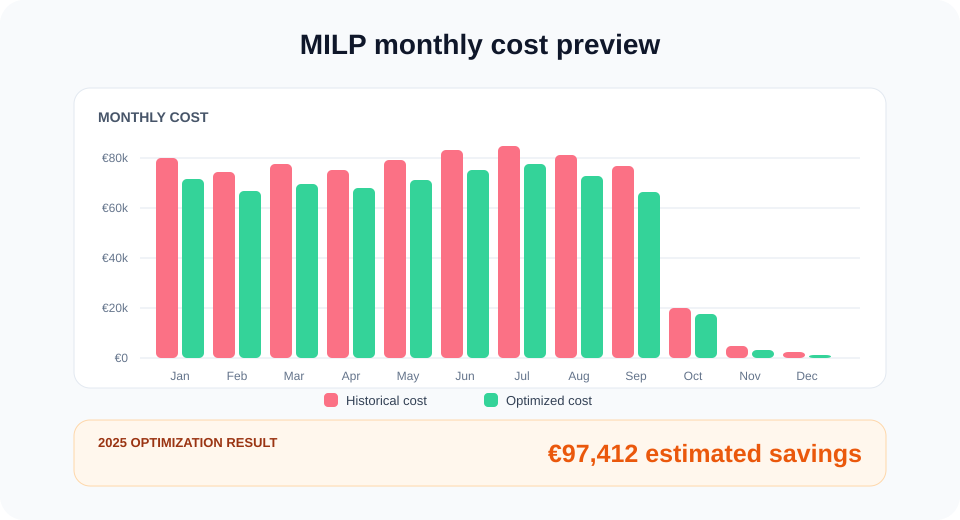
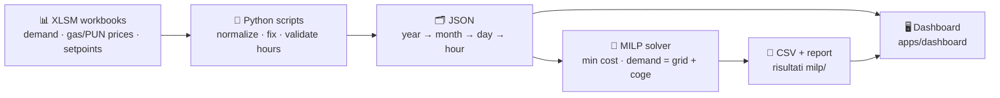

<div align="center">

# ⚡ Concast Energy Dashboard

**From raw XLSM workbooks to hour‑by‑hour energy decisions.**
Demand, cogeneration, grid, CO₂ and cost, plus a MILP optimizer that shows what smarter dispatch would have saved.


<br>



<sub><i>2025, monthly horizon: historical cost (red) vs MILP‑optimized cost (green).</i></sub>

</div>

---

## 💶 The headline

The MILP optimizer replays each year with a better grid‑vs‑cogeneration mix. Same plant, same demand, same prices.

<table>
<tr>
<td align="center" width="25%"><h2>€107.8k</h2><sub>saved in 2025<br>(hourly horizon)</sub></td>
<td align="center" width="25%"><h2>−14.7%</h2><sub>electricity spend<br>vs historical</sub></td>
<td align="center" width="25%"><h2>€101.8k</h2><sub>saved in 2024<br>(hourly horizon)</sub></td>
<td align="center" width="25%"><h2>100%</h2><sub>cogeneration<br>self‑consumed</sub></td>
</tr>
</table>

<details>
<summary><b>All horizons</b> (from <code>risultati milp/&lt;year&gt;/&lt;horizon&gt;/report.txt</code>)</summary>

| Year | Horizon | Historical | Optimized | Savings | Load covered by coge |
| --- | --- | ---: | ---: | ---: | ---: |
| 2025 | hourly  | €733,666 | €625,827 | **€107,839 (14.7%)** | 56.4% |
| 2025 | daily   | €733,666 | €629,988 | €103,678 (14.1%) | 54.5% |
| 2025 | weekly  | €733,666 | €635,355 | €98,311 (13.4%)  | 52.2% |
| 2025 | monthly | €733,666 | €636,255 | €97,412 (13.3%)  | 52.0% |
| 2024 | hourly  | €823,705 | €721,885 | **€101,820 (12.4%)** | 57.7% |
| 2024 | daily   | €823,705 | €727,973 | €95,732 (11.6%)  | 55.4% |
| 2024 | weekly  | €823,705 | €733,625 | €90,080 (10.9%)  | 53.3% |
| 2024 | monthly | €823,705 | €735,055 | €88,650 (10.8%)  | 52.9% |

The finer the horizon, the bigger the savings: hourly decisions follow price swings that monthly plans can't.

</details>

---

## 🧭 What's inside

| Page | What it answers |
| --- | --- |
| 🏠 **Dashboard** · `index.html` | How is the plant doing? Overall KPIs, demand, cogeneration, grid purchases and savings, hour by hour. |
| 📈 **Statistiche EE** · `stats.html` | What does electric demand look like day by day? Detailed electricity statistics. |
| 🧮 **MILP** · `milp.html` | What would optimal dispatch have cost? Coverage, savings vs baseline and grid vs coge split, by hour, day, week or month. |
| 🔭 **Scenario 2026** · `forecast.html` | What's next? History plus FV12 solar plus three PUN/PSV price scenarios, with a suggested coge mode per month. |
| 🌱 **CO₂** · `co2.html` | How much CO₂ do we avoid? Savings translated into plain‑language comparisons. |
| 🏭 **Shift produzione** · `prodopti.html` | Does moving production in time pay off? Seasonal timetables with one vs three solar panels. |

---

## 🔁 How the data flows



| Stage | What happens | Where |
| --- | --- | --- |
| **Source** | Hourly workbooks per year and scenario (`normal`, `fv12`, `350` variants). | `data V3/`, `data V4/` |
| **Clean** | Scripts normalize headers, fix formats and coge edge cases, and validate every hour. | `data-pipeline/*.py` |
| **Shape** | Output becomes nested `year → month → day → hour` JSON. | `data-pipeline/<year>/<scenario>/*_estratti_<year>.json` |
| **Optimize** | The MILP balances demand = grid + coge, respects setpoints and minimizes total cost. | `risultati milp/<year>/<horizon>/` |
| **Serve** | The dashboard fetches JSON and CSV straight from disk. Nothing is edited by hand. | `apps/dashboard/data/` |

> **Every chart traces back to a specific workbook and script.** No numbers are typed in by hand.

---

## 🚀 Run it locally

No build step and no dependencies. It's a static site.

```bash
cd apps/dashboard
python3 -m http.server 8000
# → open http://localhost:8000
```

**Deploy:** `apps/dashboard` is configured for Firebase Hosting (`firebase deploy` from that folder). Any static host works.

**Windows, no Python:** [`desktop/windows_launcher`](desktop/windows_launcher/README.md) builds a one‑click `ConcastDashboard.exe` that serves the dashboard from the system tray.

---

## 🗂️ Repo map

```
apps/dashboard/          static site: HTML, CSS, vanilla JS, data/
apps/prototypes/         experiments before they reach production
data-pipeline/           XLSM → JSON scripts and per-year/scenario outputs
risultati milp/          MILP solver outputs: CSV, report.txt, plots
services/forecasting/    2026 forecast builders and PUN estimators
desktop/windows_launcher Windows .exe packaging
docs/                    architecture notes and README assets
```

See [`docs/ARCHITECTURE.md`](docs/ARCHITECTURE.md) for workflows such as adding a new year of data, and [`DESIGN_SYSTEM.md`](DESIGN_SYSTEM.md) for the UI rules.

---

<div align="center">

### Why it matters

**Transparent:** every number is auditable · **Proven:** about €100k/year of optimization upside · **Ready for the future:** solar and market shifts are already modeled · **Fast:** history, optimization and forecast in one place

</div>
